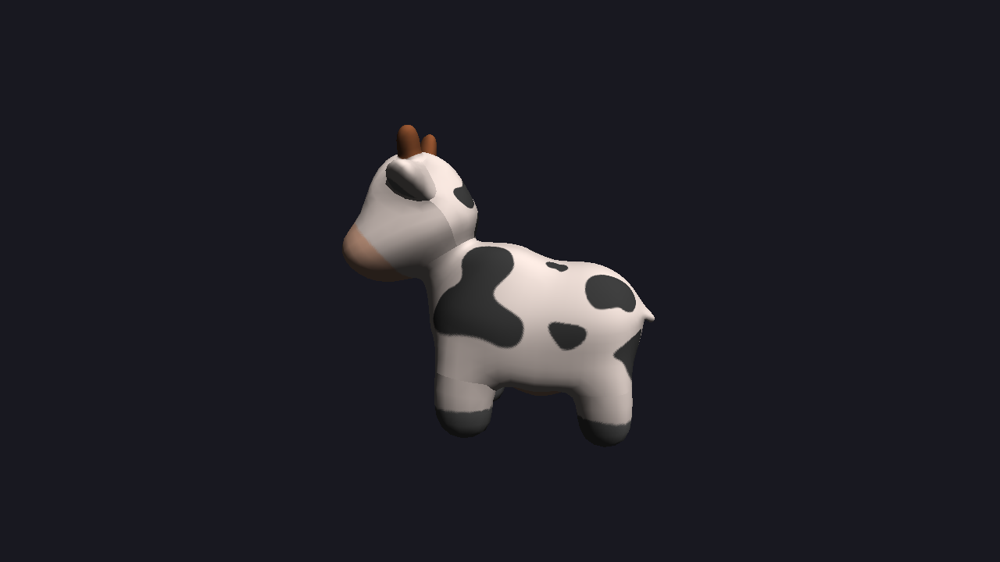
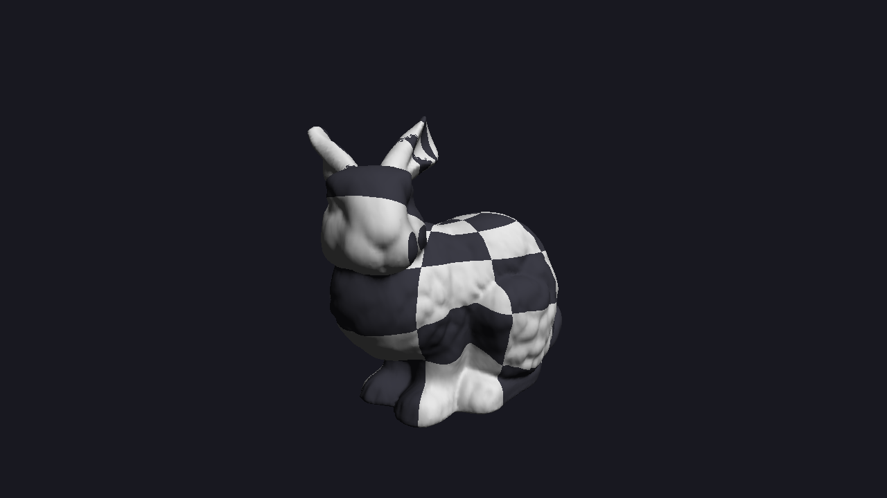
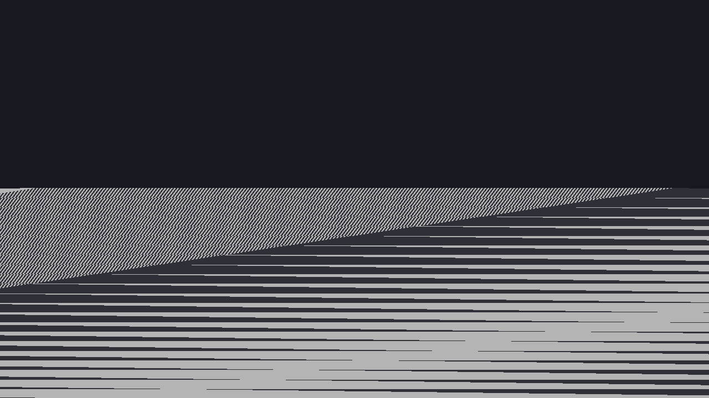
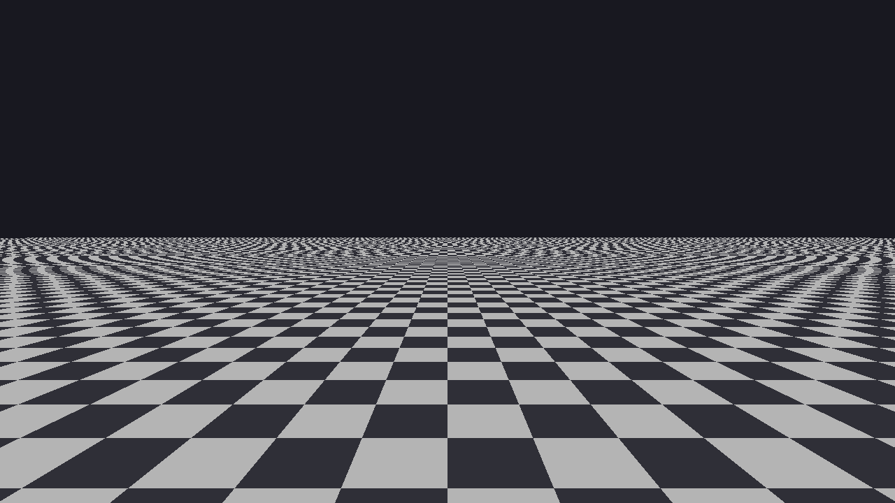
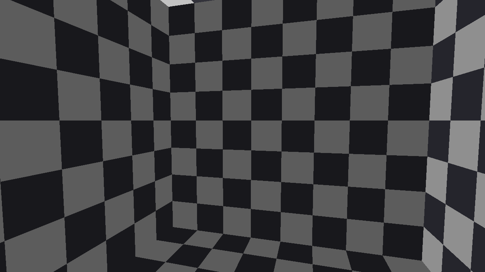

# soft-raster

A CPU software rasterizer in C++20 that implements the GPU graphics pipeline from scratch: transforms, near-plane clipping, fixed-point edge-function rasterization, depth testing, and perspective-correct texture mapping with Lambert lighting. No OpenGL, Vulkan or Metal in the render path; SDL2 only displays the finished framebuffer.

<p align="center">
  
  
</p>

**Scalar baseline:** the 69,451-triangle Stanford bunny renders in about **5 ms per frame** at 1280×720 (≈200 fps), single-threaded with no SIMD, on an Apple M1 Pro.

## Pipeline

Each frame runs these stages on the CPU:

1. **Vertex stage:** model, view and projection matrices (4×4, column-major) take every vertex to clip space. Normals are transformed to world space for lighting.
2. **Frustum rejection and clipping:** triangles entirely outside one frustum plane are skipped. Triangles crossing the near plane are clipped in homogeneous clip space (Sutherland–Hodgman) before the perspective divide, so geometry behind the camera never projects through the eye. Other planes use guard-band clipping: the rasterizer's bounding box is clamped to the screen.
3. **Perspective divide and viewport transform:** clip space to pixel coordinates, keeping 1/w per vertex.
4. **Triangle setup:** positions are snapped to a 28.4 fixed-point grid (1/16 pixel). Back faces are culled by the sign of the triangle's integer signed area.
5. **Rasterization:** three integer edge functions per pixel, evaluated at pixel centers, with the top-left fill rule. Because the math is exact, triangles that share an edge never leave a gap or draw a pixel twice.
6. **Depth test (early-z):** NDC depth in [0, 1], interpolated with screen-space barycentrics and tested before any shading.
7. **Interpolation and shading:** texture coordinates and normals use perspective-correct barycentrics (weighted by 1/w), then nearest-neighbour texture sampling and Lambert diffuse lighting.

### Perspective-correct interpolation

Interpolating texture coordinates linearly in screen space (left) warps a textured ground plane made of two triangles. Interpolating `uv/w` and `1/w`, then dividing (right), keeps the checker lines straight.

<p align="center">
  
  
</p>

### Near-plane clipping

The camera sits inside a cube, 5 cm from a wall. Walls that pass behind the camera are clipped at the near plane instead of projecting into garbage.

<p align="center">
  
</p>

## Scalar baseline

Release build (`-O3`), single thread, no SIMD. Apple M1 Pro (6 performance + 2 efficiency cores), Apple clang 17, on AC power. Median and 95th-percentile frame time over 200 frames after 20 warm-up frames, rendered headless (no window or display cost).

| Scene | Triangles | 1280×720 median / p95 | 1920×1080 median / p95 |
| --- | ---: | ---: | ---: |
| `bunny` (Stanford bunny) | 69,451 | 4.49 / 5.04 ms | 7.18 / 7.69 ms |
| `spot` (textured cow) | 5,856 | 1.57 / 1.84 ms | 3.19 / 3.73 ms |
| `cube` | 12 | 1.52 / 1.71 ms | 3.47 / 3.79 ms |
| `plane` (ground plane to the horizon) | 2 | 6.12 / 6.39 ms | 13.80 / 14.25 ms |

Notes:

- **Run-to-run noise is about 15%.** Four runs of `bunny` at 1280×720 gave medians of 4.49, 4.51, 4.95 and 5.15 ms. The table shows one run per configuration (for `bunny` at 1280×720, the 4.49 ms run). These numbers were taken before the first commit; later results will record the commit they came from.
- **Pixels cost more than triangles.** The 2-triangle `plane` is the slowest scene because it covers most of the screen, and every covered pixel is depth-tested and shaded. For the bunny, the vertex stage is about 0.1 ms of the 4.5 ms frame. Nearly all time is spent in rasterization and shading, which is where SIMD and multithreading will be aimed.
- The difference between the frame time and the per-stage times (≈0.1–0.3 ms) is clearing the color and depth buffers.

## Correctness

The renderer is checked by unit tests run under AddressSanitizer and UndefinedBehaviorSanitizer:

- **Fill rule:** grids of triangles sharing edges (including edges exactly through pixel centers and randomly jittered shared vertices) must cover every pixel exactly once. A counter buffer catches any gap (0) or double-draw (2). Two different triangulations of the same polygon must cover identical pixels.
- **Depth and culling:** overlapping triangles give the same image in either draw order; a closed mesh renders identically with and without back-face culling.
- **Clipping:** correct vertex counts and interpolated attributes when one or two vertices are behind the near plane; a camera inside a cube produces no NaNs and no out-of-range depth.
- **Math:** multiplication order, rotation direction, and the perspective matrix mapping the near plane to depth 0 and the far plane to 1.
- **Tiles:** drawing tile by tile with a scissor rectangle produces exactly the same image as drawing once (groundwork for multithreading).

## Build and run

Requires CMake 3.25+, a C++20 compiler and SDL2 (`brew install cmake sdl2`).

```sh
cmake --preset release && cmake --build --preset release
cmake --preset debug   && cmake --build --preset debug     # ASan + UBSan

./build/release/soft_raster --scene spot                   # window: Space pause, P perspective, C culling, L lighting
./build/release/soft_raster --scene plane --headless --out out/plane.png
./build/release/sr_bench --scene bunny --config scalar     # appends to results/results.csv
./build/debug/sr_tests
```

Scenes: `triangles`, `cube`, `intersect`, `inside`, `plane`, `bunny`, `spot`, or a path to any `.obj` file.

## Next

- Golden-image tests, so every optimized path is checked pixel-for-pixel against the scalar renderer
- SIMD rasterization with ARM NEON (2×2 pixel blocks)
- Multithreading with screen-space tile binning and a custom thread pool
- Each optimization measured against this baseline, with predictions written down before each experiment

## Third-party code and assets

SDL2 (window only), stb_image / stb_image_write, tinyobjloader and doctest; versions and licenses in `third_party/README.md`. The Stanford bunny (Stanford Computer Graphics Laboratory) and Spot (Keenan Crane, CC0); sources in `assets/README.md`.
